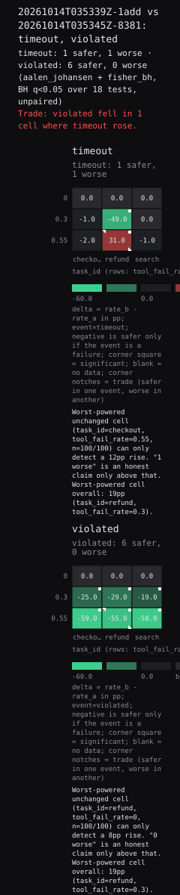

# 20261014T035339Z-1add vs 20261014T035345Z-8381: timeout, violated

timeout: 1 safer, 1 worse · violated: 6 safer, 0 worse
(aalen_johansen + fisher_bh, BH q<0.05 over 18 tests, unpaired)

Trade: violated fell in 1 cell where timeout rose.

## Omnibus

"no cell changed" is rejected (p = 0.000249938 < q 0.05) over 9 cells x 2 events

min-p of location and dispersion; 4000 within-cell permutations, arm_label, seed 0

p floor 2.50e-04: the smallest p 4000 permutations can express; a p at the floor is a bound, not a measurement

| event | mean delta (pp) | p | rms delta (pp) | p |
|---|---|---|---|---|
| timeout | -2.4 | 0.0205 | 19.3 | 2.50e-04 |
| violated | -27.2 | 2.50e-04 | 36.1 | 2.50e-04 |

informative cells: 6 of 9; 3 unchanged by every exchange

## Fault lines

grouping task_id (axis), 3 groups; cells per group min 3 / median 3 / max 3; 0 degenerate; 3 of 3 groups resolve 20pp at alpha 0.0167

"no cell in the group changed" tested by BH across 3 groups at q 0.05: 3 rejected

group p floor 2.50e-04: the same 4000 permutations; a group p at the floor is a bound, not a measurement

| task_id | cells | informative | unchanged by every exchange | units (a/b) | group MDE (pp) | p | q | verdict |
|---|---|---|---|---|---|---|---|---|
| checkout | 3 | 2 | 1 | 300/300 | 13.1pp | 2.50e-04 | 2.50e-04 | rejected |
| refund | 3 | 2 | 1 | 300/300 | 13.1pp | 2.50e-04 | 2.50e-04 | rejected |
| search | 3 | 2 | 1 | 300/300 | 13.1pp | 2.50e-04 | 2.50e-04 | rejected |

## Cells

"this cell did not change" tested by BH within each of 3 rejecting groups at q 0.05: 8 of 18 rejected

MDE is the smallest detectable increase from arm A's rate, capped at the headroom, so on a cell at ceiling it reads the headroom and is not a power number.

task_id=checkout: 6 tests, 2 rejected; cell MDE median 9pp / max 19pp

| cell | event | delta (pp) | q | MDE |
|---|---|---|---|---|
| task_id=checkout, tool_fail_rate=0.3 | violated | -25.0 | 2.20e-07 | 19pp |
| task_id=checkout, tool_fail_rate=0.55 | violated | -59.0 | 1.33e-17 | 9pp |

task_id=refund: 6 tests, 4 rejected; cell MDE median 14pp / max 19pp

| cell | event | delta (pp) | q | MDE |
|---|---|---|---|---|
| task_id=refund, tool_fail_rate=0.3 | timeout | -49.0 | 5.61e-16 | 19pp |
| task_id=refund, tool_fail_rate=0.3 | violated | -29.0 | 5.35e-09 | 19pp |
| task_id=refund, tool_fail_rate=0.55 | timeout | 31.0 | 5.38e-06 | 17pp |
| task_id=refund, tool_fail_rate=0.55 | violated | -55.0 | 6.46e-15 | 12pp |

task_id=search: 6 tests, 2 rejected; cell MDE median 9pp / max 18pp

| cell | event | delta (pp) | q | MDE |
|---|---|---|---|---|
| task_id=search, tool_fail_rate=0.3 | violated | -19.0 | 4.45e-06 | 18pp |
| task_id=search, tool_fail_rate=0.55 | violated | -58.0 | 5.82e-16 | 13pp |

## Bound

depth 3 (3 configured); outer-nodes false discovery rate at most 0.432 = 2 x 3 x 0.05 x 1.44

Yekutieli (2008) Corollary A.2 assumes each p-value is independent of its ancestors; this tree's group and root statistics aggregate their own cells, so that assumption is not established here.

## timeout: 1 safer, 1 worse

| task_id | tool_fail_rate | n (a/b) | rate_a (pp) | rate_b (pp) | delta (pp) | p | q | verdict | MDE | interval (pp) |
|---|---|---|---|---|---|---|---|---|---|---|
| refund | 0.55 | 100/100 | 16.0 | 47.0 | 31.0 | 3.59e-06 | 8.08e-06 | worse | 17pp | [16.3, 44.6] |
| search | 0.3 | 100/100 | 0.0 | 0.0 | 0.0 | 1 | 1 | unchanged | 8pp | [-5.0, 5.0] |
| refund | 0 | 100/100 | 0.0 | 0.0 | 0.0 | 1 | 1 | unchanged | 8pp | [-5.0, 5.0] |
| search | 0 | 100/100 | 0.0 | 0.0 | 0.0 | 1 | 1 | unchanged | 8pp | [-5.0, 5.0] |
| checkout | 0 | 100/100 | 0.0 | 0.0 | 0.0 | 1 | 1 | unchanged | 8pp | [-5.0, 5.0] |
| checkout | 0.3 | 100/100 | 1.0 | 0.0 | -1.0 | 1 | 1 | unchanged | 9pp | [-6.8, 4.0] |
| search | 0.55 | 100/100 | 1.0 | 0.0 | -1.0 | 1 | 1 | unchanged | 9pp | [-6.8, 4.0] |
| checkout | 0.55 | 100/100 | 4.0 | 2.0 | -2.0 | 0.683 | 1 | unchanged | 12pp | [-9.5, 4.8] |
| refund | 0.3 | 100/100 | 51.0 | 2.0 | -49.0 | 9.34e-17 | 5.82e-16 | safer | 19pp | [-60.5, -37.0] |

Worst-powered unchanged cell (task_id=checkout, tool_fail_rate=0.55, n=100/100) can only detect a 12pp rise. "1 worse" is an honest claim only above that.
Worst-powered cell overall: 19pp (task_id=refund, tool_fail_rate=0.3).

## violated: 6 safer, 0 worse

| task_id | tool_fail_rate | n (a/b) | rate_a (pp) | rate_b (pp) | delta (pp) | p | q | verdict | MDE | interval (pp) |
|---|---|---|---|---|---|---|---|---|---|---|
| refund | 0 | 100/100 | 0.0 | 0.0 | 0.0 | 1 | 1 | unchanged | 8pp | [-5.0, 5.0] |
| search | 0 | 100/100 | 0.0 | 0.0 | 0.0 | 1 | 1 | unchanged | 8pp | [-5.0, 5.0] |
| checkout | 0 | 100/100 | 0.0 | 0.0 | 0.0 | 1 | 1 | unchanged | 8pp | [-5.0, 5.0] |
| search | 0.3 | 100/100 | 19.0 | 0.0 | -19.0 | 1.48e-06 | 3.82e-06 | safer | 18pp | [-29.4, -11.6] |
| checkout | 0.3 | 100/100 | 26.0 | 1.0 | -25.0 | 7.33e-08 | 2.20e-07 | safer | 19pp | [-36.2, -15.6] |
| refund | 0.3 | 100/100 | 30.0 | 1.0 | -29.0 | 2.67e-09 | 9.63e-09 | safer | 19pp | [-40.4, -19.1] |
| refund | 0.55 | 100/100 | 84.0 | 29.0 | -55.0 | 2.15e-15 | 9.69e-15 | safer | 12pp | [-66.9, -40.4] |
| search | 0.55 | 100/100 | 80.0 | 22.0 | -58.0 | 9.69e-17 | 5.82e-16 | safer | 13pp | [-69.6, -43.4] |
| checkout | 0.55 | 100/100 | 90.0 | 31.0 | -59.0 | 2.22e-18 | 3.99e-17 | safer | 9pp | [-70.2, -45.1] |

Worst-powered unchanged cell (task_id=refund, tool_fail_rate=0, n=100/100) can only detect a 8pp rise. "0 worse" is an honest claim only above that.
Worst-powered cell overall: 19pp (task_id=refund, tool_fail_rate=0.3).

## Intervals

intervals: 97.7778% (alpha* = 0.0222222 = q x 8 / 18 over the flat BH family), basis score_rd

interval excludes zero, verdict unchanged: 0 cells

verdict significant, interval covers zero: 0 cells

> This is empirical evidence under a stated test envelope, not formal verification. Cells outside the envelope were not tested; cells inside it were tested at the stated replicate count and can only detect effects at or above the reported MDE.

## Provenance

- events: timeout, violated
- inferred: false
- non event: none
- n tests: 18
- method: fisher_bh
- seed identity match: true
- unpaired analysis: true
- q: 0.05
- t unit: tool_calls
- horizon: 20
- n not comparable: 0
- dropped a: 0
- dropped b: 0
- episodes censored at horizon: 0
- n absent: 0
- proofload version: 0.0.1
- run id a: 20261014T035339Z-1add
- run id b: 20261014T035345Z-8381
- run salt: 5cd33a2df543b317
- observation cap a: not recorded
- observation cap b: not recorded
- trace spans a: 10525
- trace spans b: 11663
- observation cut spans a: 0
- observation cut spans b: 0
